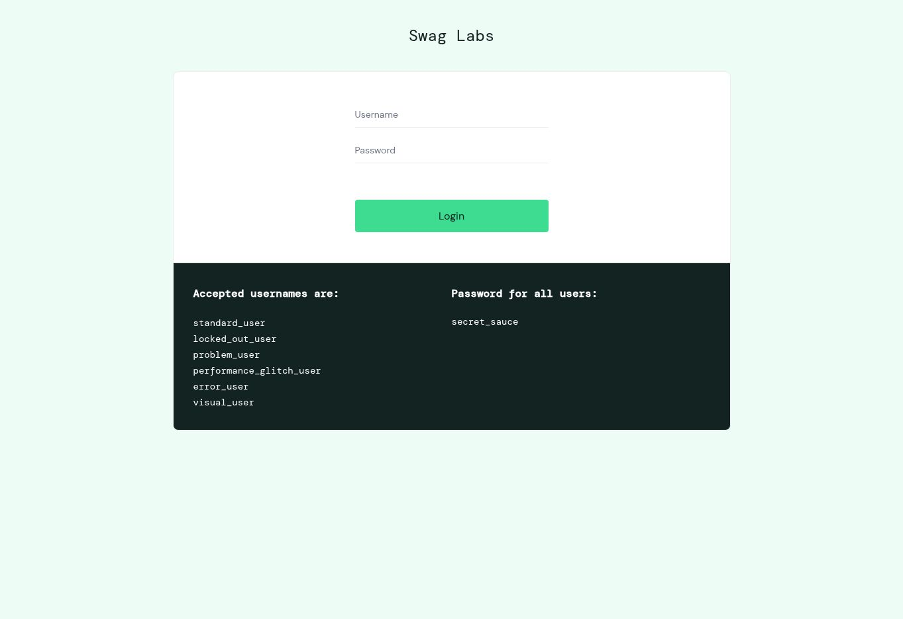

# Online Shop Manual Testing

A beginner QA portfolio project for [SauceDemo / Swag Labs](https://www.saucedemo.com/), covering login, product details, sorting, cart behaviour, checkout and logout.

**Project stage: planned test execution completed; final documentation review in progress.**

## Recorded results

| Measure | Current value |
| --- | ---: |
| Designed test cases | 25 |
| Unique test cases executed | 25 |
| Passed | 25 |
| Failed | 0 |
| Not run | 0 |
| Confirmed defects | 0 |
| Open observations | 1 |

These figures combine the recorded results across R01, R02 and R03, counting each test case once. Earlier “Not run” entries remain in R01 as historical records.

Passing the planned cases does not mean the application is defect-free or ready for production.

## Work completed

- Checked the login page and successful login.
- Tested incorrect credentials, empty fields and a locked account.
- Compared product information between the catalogue and details page.
- Checked price and alphabetical sorting.
- Tested adding and removing cart items.
- Checked cart persistence after refresh and navigation.
- Tested required checkout fields and valid checkout information.
- Independently checked the subtotal and final total arithmetic.
- Tested checkout cancellation and demo order completion.
- Checked logout and rejection of direct catalogue access after logout.
- Recorded results and linked screenshot evidence using Markdown and GitHub.

## Open observation

Some login error text appeared partly clipped in screenshots, including the login-required message after attempting to access the catalogue while logged out.

The relevant functional checks passed, but the visual behaviour needs further investigation. This is an open observation, not a confirmed defect. Browser zoom, window size and reproducibility have not yet been established.

## Read the project

1. [Test plan and scope](docs/test-plan.md)
2. [Detailed test cases](test-cases/test-cases.md)
3. [Execution log](test-cases/execution-log.md)
4. [Test summary](docs/test-summary.md)
5. [Evidence index](evidence/README.md)
6. [Defect register and reporting template](bug-reports/README.md)
7. [Step-by-step execution guide](docs/execution-guide.md)
8. [GitHub publishing guide](docs/github-guide.md)

## Tools and techniques

**Tools:** Web browser, screenshots, VS Code, Markdown, Git, GitHub and PowerShell.

**Techniques:** Positive and negative testing, risk-based prioritisation, boundary checks, state transitions, persistence checks, navigation checks and arithmetic verification.

## Attribution and limitations

This is a personal learning project by Thura Aung, prepared with ChatGPT assistance for test design, guidance and documentation.

ChatGPT performed the initial login-page check, TC-001, in R01 on 12 September 2026. Thura Aung performed the subsequent manual testing recorded in R02 and R03.

This project demonstrates manual testing practice. It does not represent employment, certification, a production security assessment or a reusable automation suite.

Expected results are project test assumptions rather than verified official business requirements. Findings apply to the tested scenarios and recorded sessions.

SauceDemo is a third-party practice application. This project does not own or maintain it.

## Initial login-page evidence

